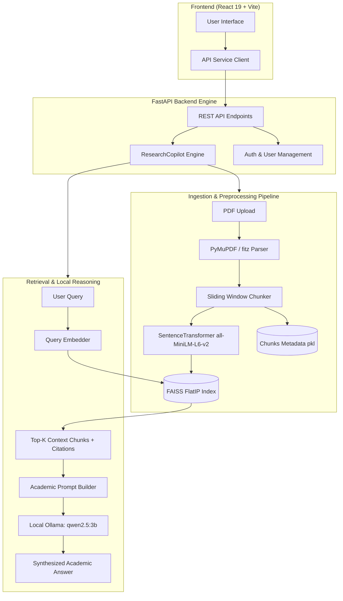

# 🧠 AI Research Copilot

[](https://fastapi.tiangolo.com)
[](https://react.dev)
[](https://vitejs.dev)
[](https://ollama.ai)
[](https://github.com/facebookresearch/faiss)
[](https://huggingface.co/sentence-transformers/all-MiniLM-L6-v2)
[](https://python.org)

An intelligent, production-ready, locally hosted **Academic Research Assistant & RAG Engine** designed to assist researchers, students, and engineers in parsing, synthesizing, comparing, and generating structured academic insights from research papers (PDFs).

Powered by **local embeddings** (`SentenceTransformers`), **FAISS vector indexing**, and **Ollama (`qwen2.5:3b`)** for 100% private, on-device generative reasoning without external API dependencies or recurring cloud costs.

---

## 🌟 Key Highlights

- **🔒 100% On-Premise & Offline-Ready**: All document ingestion, chunking, vectorization, and inference happen locally on your hardware.
- **🎯 Page-Level Source Attribution**: Zero blind hallucination. Answers cite exact paper names, page numbers, and cosine similarity confidence scores.
- **⚡ Synchronized Vector Indexing**: Uploading and deleting papers triggers automated chunking, embedding generation, and real-time FAISS index synchronization.
- **🎨 Modern Dark Glassmorphism UI**: High-productivity React interface with interactive tabs, responsive modals, and direct PDF viewing.

---

## 🚀 Core Features

| Feature | Description |
| :--- | :--- |
| **💬 RAG Semantic Chat** | Ask questions across indexed papers with strict anti-hallucination prompting, multi-document context retrieval, and direct source snippets with page numbers. |
| **📑 Deep Paper Analysis** | Automatically extracts Problem Statements, Methodologies, Mathematical Formulations, Datasets, Key Findings, Limitations, and Contributions for any single paper. |
| **⚖️ Multi-Paper Comparison** | Select 2 or more research papers to generate side-by-side comparative matrices analyzing differences in formulation, architectures, benchmarks, and tradeoffs. |
| **💡 Research Gap Identifier** | Scans paper corpora for explicit limitations, bottlenecks, unaddressed challenges, and synthesizes novel dissertation/project research proposals. |
| **📖 Chapter 2 Literature Review** | Synthesizes multiple papers into a formal, publication-ready academic Literature Review formatted from Sections 2.1 to 2.8 with theoretical continuity. |
| **🏷️ Citation Generator** | Instantly extracts bibliographic metadata and generates standardized academic citations in **IEEE**, **APA**, **MLA**, and **Chicago** formats. |
| **📂 Knowledge Base & PDF Viewer** | Upload new PDF research papers, view extraction stats, inspect chunk counts, preview PDFs in-app, or safely purge papers with auto-reindexing. |
| **🔐 Authentication & Security** | Pluggable JWT-based user authentication system with bcrypt password hashing and email verification/password reset services. |

---

## 🏗️ System Architecture



---

## 📁 Repository Structure

```
AI RESEARCH COPLOIT/
├── backend/
│   ├── app.py                  # FastAPI application entry point & API routes
│   ├── research_copilot.py     # Core AI Engine (Ingestion, FAISS, Ollama RAG)
│   ├── config.py               # Environment configuration settings
│   ├── database.py             # SQLAlchemy DB engine & session
│   ├── models.py               # DB models (User, Token, Paper metadata)
│   ├── schemas.py              # Pydantic schemas for request validation
│   ├── dependencies.py         # Auth & DB dependency injectors
│   ├── security.py             # JWT & bcrypt password utilities
│   ├── email_service.py        # Verification & reset email provider
│   ├── requirements.txt        # Backend Python dependencies
│   ├── .env.example            # Sample backend configuration template
│   └── routes/
│       ├── auth_routes.py      # Registration, Login, Token refresh
│       └── user_routes.py      # User profile & account management
├── frontend/
│   ├── src/
│   │   ├── components/         # Modular views (Chat, Analysis, Compare, Gaps, etc.)
│   │   ├── services/api.js     # Axios/Fetch integration with FastAPI
│   │   ├── App.jsx             # Main application orchestrator & tab routing
│   │   ├── App.css             # Main styling & layout tokens
│   │   └── index.css           # Global theme & typography rules
│   ├── package.json            # Frontend package manifest
│   └── vite.config.js          # Vite build & proxy configuration
├── research_papers/            # Ingested PDF documents storage
├── extracted_text/             # Extracted raw text dumps from PDFs
├── vector_db/
│   ├── research.index          # Persisted FAISS vector index
│   └── chunks.pkl              # Chunk metadata, page mappings & snippets
├── model/
│   └── embedding_model/        # Local all-MiniLM-L6-v2 SentenceTransformer
├── outputs/                    # Exported literature reviews, reports, comparisons
└── data/                       # SQLite database files
```

---

## 🛠️ Prerequisites

Before running the project, make sure the following dependencies are installed:

1. **Python 3.10+**: [Download Python](https://www.python.org/downloads/)
2. **Node.js 18+ & npm**: [Download Node.js](https://nodejs.org/)
3. **Ollama**: [Download Ollama](https://ollama.ai/)
   - Pull the recommended local language model:
     ```bash
     ollama pull qwen2.5:3b
     ```
   - Ensure the Ollama daemon is running:
     ```bash
     ollama serve
     ```

---

## ⚙️ Quick Start Installation

### 1. Clone or Open the Repository
```bash
cd "AI RESEARCH COPLOIT"
```

### 2. Backend Setup
1. Open a terminal and navigate to the `backend/` directory:
   ```bash
   cd backend
   ```
2. Create and activate a Python virtual environment:
   ```bash
   # Windows PowerShell
   python -m venv venv
   .\venv\Scripts\Activate.ps1

   # Linux / macOS
   python3 -m venv venv
   source venv/bin/activate
   ```
3. Install required Python packages:
   ```bash
   pip install -r requirements.txt
   ```
4. Configure your `.env` file:
   ```bash
   cp .env.example .env
   ```
   *(By default, SQLite and local Ollama `qwen2.5:3b` are pre-configured in `.env.example`.)*

5. Run the FastAPI development server:
   ```bash
   python -m uvicorn app:app --host 127.0.0.1 --port 8000 --reload
   ```
   The backend API will be available at: **`http://127.0.0.1:8000`**  
   Interactive API documentation (Swagger UI): **`http://127.0.0.1:8000/docs`**

---

### 3. Frontend Setup
1. Open a new terminal and navigate to the `frontend/` directory:
   ```bash
   cd frontend
   ```
2. Install frontend dependencies:
   ```bash
   npm install
   ```
3. Start the Vite development server:
   ```bash
   npm run dev
   ```
   The frontend UI will be running at: **`http://localhost:5173`**

---

## 📖 API Endpoints Reference

| Method | Endpoint | Description |
| :--- | :--- | :--- |
| `GET` | `/health` | Live diagnostic status of FAISS index, embedding model & Ollama |
| `GET` | `/papers` | List all indexed papers, chunk counts, and page statistics |
| `POST` | `/upload` | Upload a new PDF paper and vectorize into the FAISS index |
| `DELETE`| `/papers/{paper_name}` | Remove a paper and auto-rebuild vector synchronization |
| `GET` | `/paper-file/{paper_name}`| Serve the raw PDF for in-browser viewing |
| `POST` | `/search` | Semantic cosine-similarity search across chunk vectors |
| `POST` | `/ask` | Complete RAG Q&A query with page-level citations |
| `POST` | `/analyze` | Comprehensive deep paper breakdown report |
| `POST` | `/compare` | Multi-paper comparison matrix across 2+ documents |
| `POST` | `/research-gap` | Analysis of corpus bottlenecks and novel project proposals |
| `POST` | `/literature-review` | Formal Chapter 2 dissertation synthesis |
| `POST` | `/citation` | Generates formatted IEEE, APA, MLA, or Chicago citation |
| `GET` | `/outputs` | List exported reports and reviews |
| `GET` | `/outputs/{filename}` | Download a generated text report |

---

## 🔧 Configuration (.env)

| Variable | Default Value | Description |
| :--- | :--- | :--- |
| `SECRET_KEY` | *(Set a random secure string)* | Used for cryptographic signing of JWT tokens |
| `ALGORITHM` | `HS256` | JWT signing algorithm |
| `ACCESS_TOKEN_EXPIRE_MINUTES` | `1440` (24h) | JWT session lifetime |
| `DATABASE_URL` | `sqlite:///../data/research_copilot.db` | Database connection URI (SQLite / PostgreSQL) |
| `OLLAMA_URL` | `http://localhost:11434` | Ollama local daemon endpoint |
| `OLLAMA_MODEL` | `qwen2.5:3b` | Target local LLM model |
| `FRONTEND_URL` | `http://localhost:5173` | Allowed CORS origin for frontend |

---

## 🎯 Usage Walkthrough

1. **Upload Papers**:
   - Navigate to the **Papers Library** tab or click **Upload PDF**.
   - Drop in any academic paper (e.g. IEEE, Springer, Nature, arXiv).
   - PyMuPDF extracts full text, chunks it, and indexes vectors into FAISS.
2. **Interact with the Copilot**:
   - Go to **Research Chat** and ask research queries (e.g., *"What deep learning architectures were used for water quality prediction?"*).
   - Filter by specific papers or query across the entire corpus.
3. **Perform Cross-Paper Comparison**:
   - Open **Compare Papers**, select two or more papers, and generate side-by-side matrices comparing algorithms, datasets, metrics, and tradeoffs.
4. **Discover New Project Gaps**:
   - Use the **Research Gaps** view to identify open challenges for your capstone project or dissertation.
5. **Generate Literature Review**:
   - Select papers and run **Literature Review** to produce formatted sections ready for your dissertation or technical paper.
6. **Export Citations**:
   - Use **Citations** to copy IEEE/APA/MLA references directly into your bibliography.

---

## 🛡️ License

This project is developed for academic and research purposes. Feel free to customize and extend it for your projects, publications, or thesis research!
